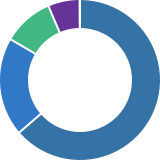
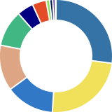

> At sufficient scale everything fails all the time, and the only real feature is being able to watch it happen.
>
> 
— me, to a 🦆

I work on the metric backend of <picture></picture> [**Checkmk**](https://github.com/Checkmk), its data backend for OpenTelemetry metrics that lets it monitor applications, not just infrastructure.\
Before that I was at <picture></picture> [**SAP**](https://github.com/SAP), building the CI/CD infrastructure for HANA (their in-memory database): a graph-based task execution framework running on **~2000 compute nodes** spread across multiple cloud providers and regions.

#### Highlights

<code>since 2021</code><samp>&nbsp;&nbsp;&nbsp;&nbsp;&nbsp;&nbsp;&nbsp;&nbsp;&nbsp;&nbsp;</samp>&emsp;<picture></picture> [**csshW**](https://github.com/whme/csshw): broadcast your keystrokes to all your SSH sessions (successor: [cssh-rs](https://github.com/whmade/cssh-rs))\
<code>PyConDE '25</code><samp>&nbsp;&nbsp;&nbsp;&nbsp;&nbsp;&nbsp;&nbsp;&nbsp;&nbsp;</samp>&emsp;<picture></picture>&nbsp; [**Rustifying Python**](https://github.com/whme/PyConDE-2025): what's worth moving to Rust, and what will go wrong

#### Recent activity

<!-- activity:start -->
<code>2026-11-19 23:29 CET</code><samp>&nbsp;</samp>&emsp;<picture></picture> <a href="https://github.com/whmade/cssh-rs"><code>whmade/cssh-rs</code></a><samp>&nbsp;&nbsp;&nbsp;&nbsp;&nbsp;&nbsp;&nbsp;&nbsp;&nbsp;&nbsp;&nbsp;</samp> <picture></picture> [Configure mattpocock skills for the…](https://github.com/whmade/cssh-rs/commit/1ec120718e3559aec9b865fecde27525cf2ade48)\
<code>(yesterday)</code><samp>&nbsp;&nbsp;&nbsp;&nbsp;&nbsp;&nbsp;&nbsp;&nbsp;&nbsp;&nbsp;</samp>&emsp;<picture></picture> <a href="https://github.com/whmade/cssh-rs"><code>whmade/cssh-rs</code></a><samp>&nbsp;&nbsp;&nbsp;&nbsp;&nbsp;&nbsp;&nbsp;&nbsp;&nbsp;&nbsp;&nbsp;</samp> <picture></picture> [573 commits](https://github.com/whmade/cssh-rs/commits?author=whme) · [133 pull requests](https://github.com/whmade/cssh-rs/pulls?q=is%3Apr+author%3Awhme) · [156 issues](https://github.com/whmade/cssh-rs/issues?q=is%3Aissue+author%3Awhme)

<code>2026-11-19 16:29 CET</code><samp>&nbsp;</samp>&emsp;<picture></picture> <a href="https://github.com/Checkmk/checkmk"><code>Checkmk/checkmk</code></a><samp>&nbsp;&nbsp;&nbsp;&nbsp;&nbsp;&nbsp;&nbsp;&nbsp;&nbsp;&nbsp;</samp> <picture></picture> [BAZEL.md: map workflows to Bazel commands](https://github.com/Checkmk/checkmk/commit/c3dd414a93c82e6c5be53a9925ade293f4c8f848)\
<code>(yesterday)</code><samp>&nbsp;&nbsp;&nbsp;&nbsp;&nbsp;&nbsp;&nbsp;&nbsp;&nbsp;&nbsp;</samp>&emsp;<picture></picture> <a href="https://github.com/Checkmk/checkmk"><code>Checkmk/checkmk</code></a><samp>&nbsp;&nbsp;&nbsp;&nbsp;&nbsp;&nbsp;&nbsp;&nbsp;&nbsp;&nbsp;</samp> <picture></picture> [747 commits](https://github.com/Checkmk/checkmk/commits?author=whme)

<code>2026-11-18 20:15 CET</code><samp>&nbsp;</samp>&emsp;<picture></picture> <a href="https://github.com/Checkmk/checkmk"><code>Checkmk/checkmk</code></a><samp>&nbsp;&nbsp;&nbsp;&nbsp;&nbsp;&nbsp;&nbsp;&nbsp;&nbsp;&nbsp;</samp> <picture></picture> [mk_sap: keep sending alerts that SAP no…](https://github.com/Checkmk/checkmk/commit/5b5c9da888f9b08923bf4b5da3489fffc0cb3aa4)\
<code>(wednesday)</code><samp>&nbsp;&nbsp;&nbsp;&nbsp;&nbsp;&nbsp;&nbsp;&nbsp;&nbsp;&nbsp;</samp>&emsp;<picture></picture> <a href="https://github.com/Checkmk/checkmk"><code>Checkmk/checkmk</code></a><samp>&nbsp;&nbsp;&nbsp;&nbsp;&nbsp;&nbsp;&nbsp;&nbsp;&nbsp;&nbsp;</samp> <picture></picture> [747 commits](https://github.com/Checkmk/checkmk/commits?author=whme)

<code>2026-11-18 18:38 CET</code><samp>&nbsp;</samp>&emsp;<picture></picture> <a href="https://github.com/whmade/claude-marketplace"><code>whmade/claude-marketplace</code></a> <picture></picture> [Challenge every character of commit…](https://github.com/whmade/claude-marketplace/commit/2082feb39053be10de28ef9ff33136f021b37611)\
<code>(wednesday)</code><samp>&nbsp;&nbsp;&nbsp;&nbsp;&nbsp;&nbsp;&nbsp;&nbsp;&nbsp;&nbsp;</samp>&emsp;<picture></picture> <a href="https://github.com/whmade/claude-marketplace"><code>whmade/claude-marketplace</code></a> <picture></picture> [7 commits](https://github.com/whmade/claude-marketplace/commits?author=whme) · [6 pull requests](https://github.com/whmade/claude-marketplace/pulls?q=is%3Apr+author%3Awhme)
<!-- activity:end -->

<!-- recent_language_bar:start -->

Last 30 days 
<picture></picture> 
<picture></picture> Python 63.7% (2.5k) · <picture></picture> TypeScript 19.8% (769) · <picture></picture> Vue 10.1% (394) · <picture></picture> CSS 6.4% (247) · Other 0.1% (3)

<table><tr>
<td><picture></picture></td>
<td>
<picture></picture> Python 63.7% (2.5k) 
<picture></picture> TypeScript 19.8% (769) 
<picture></picture> Vue 10.1% (394) 
<picture></picture> CSS 6.4% (247) 
<picture></picture> Shell 0.1% (3)
</td>
</tr></table>

| | Language | | Share | Lines added |
|---|:--|:--|--:|--:|
| <picture></picture> | Python | <picture></picture> | 63.7% | 2,475 |
| <picture></picture> | TypeScript | <picture></picture> | 19.8% | 769 |
| <picture></picture> | Vue | <picture></picture> | 10.1% | 394 |
| <picture></picture> | CSS | <picture></picture> | 6.4% | 247 |
|  | Shell | <picture></picture> | 0.1% | 3 |

<!-- recent_language_bar:end -->

<!-- all_time_language_bar:start -->

All time 
<picture></picture> 
<picture></picture> Python 27.1% (83.1k) · <picture></picture> JavaScript 24.0% (73.5k) · <picture></picture> TypeScript 13.9% (42.8k) · <picture></picture> Rust 13.1% (40.1k) · <picture></picture> Vue 10.4% (31.9k) · Other 11.5% (35.4k)

<table><tr>
<td><picture></picture></td>
<td>
<picture></picture> Python 27.1% (83.1k) 
<picture></picture> JavaScript 24.0% (73.5k) 
<picture></picture> TypeScript 13.9% (42.8k) 
<picture></picture> Rust 13.1% (40.1k) 
<picture></picture> Vue 10.4% (31.9k) 
<picture></picture> Lua 4.7% (14.4k) 
<picture></picture> HTML 4.0% (12.3k) 
<picture></picture> Shell 1.0% (3.1k) 
<picture></picture> PowerShell 0.9% (2.7k) 
<picture></picture> CSS 0.7% (2.2k) 
<picture></picture> Java 0.2% (684) 
<picture></picture> Go 0.0% (4)
</td>
</tr></table>

| | Language | | Share | Lines added |
|---|:--|:--|--:|--:|
| <picture></picture> | Python | <picture></picture> | 27.1% | 83,057 |
| <picture></picture> | JavaScript | <picture></picture> | 24.0% | 73,497 |
| <picture></picture> | TypeScript | <picture></picture> | 13.9% | 42,767 |
| <picture></picture> | Rust | <picture></picture> | 13.1% | 40,130 |
| <picture></picture> | Vue | <picture></picture> | 10.4% | 31,918 |
| <picture></picture> | Lua | <picture></picture> | 4.7% | 14,447 |
|  | HTML | <picture></picture> | 4.0% | 12,273 |
|  | Shell | <picture></picture> | 1.0% | 3,065 |
| <picture></picture> | PowerShell | <picture></picture> | 0.9% | 2,694 |
| <picture></picture> | CSS | <picture></picture> | 0.7% | 2,238 |
|  | Java | <picture></picture> | 0.2% | 684 |
|  | Go | <picture></picture> | 0.0% | 4 |

<!-- all_time_language_bar:end -->

<!-- last_updated:start -->

Last updated 2026-11-20 08:45 CET.

<!-- last_updated:end -->

Everything above refreshes every few hours via a [small workflow](.github/workflows/update-readme.yml). Here's [how it's computed](readme_updater/README.md).\
The 🦆 is maintained by hand.
